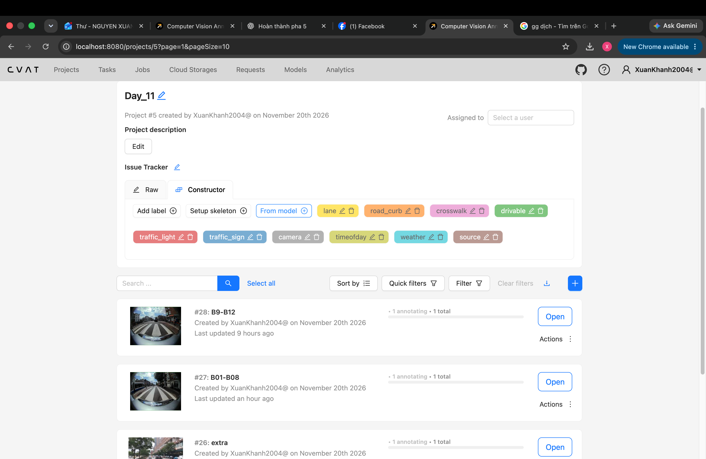
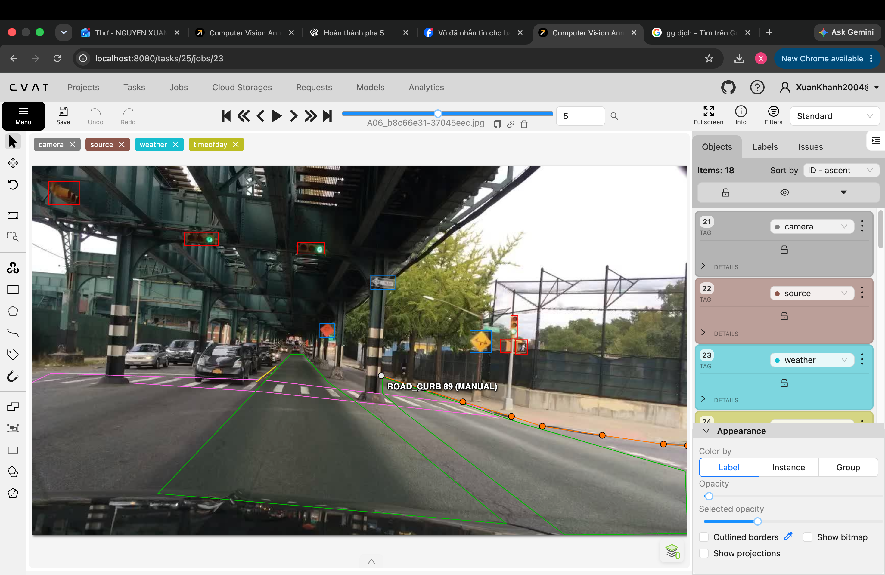
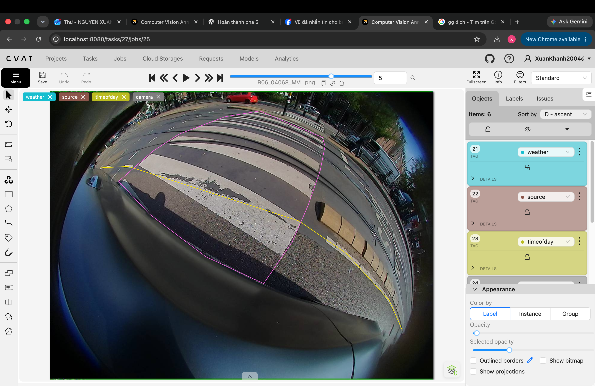
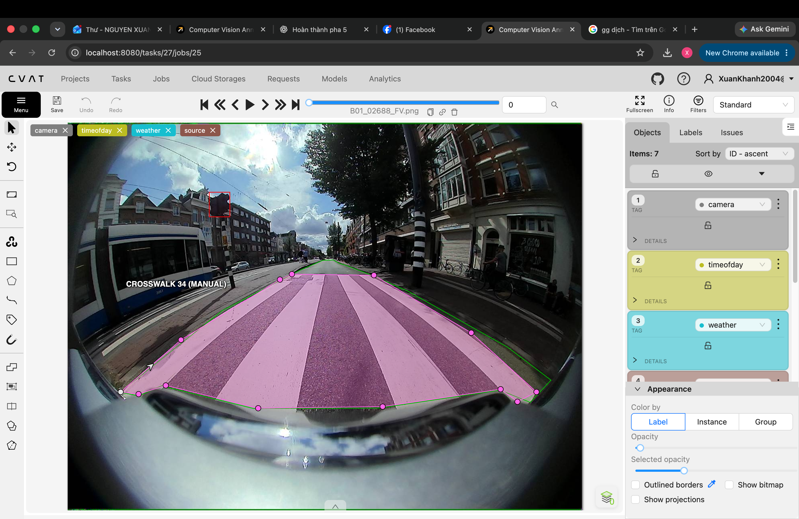

# Báo cáo cá nhân — Ngày 11
Họ tên: Nguyễn Xuân Khánh               Mã học viên: 2A202603075  
Phiên bản CVAT (Help → About): localhost:808
Guideline: Road v1.0    Lần nộp (`revision` trong manifest): 1  
Thời điểm export (ngày giờ trên CVAT): 2026-11-20, job front cập nhật 18:49 UTC, job fisheye 18:43 UTC (manifest tạo 18:52 UTC)    Số lần nộp lại sau Rework: 0

## 1. Kiểm project
| Mục | Đúng như guideline Road v1.0? | Ghi chú |
| --- | --- | --- |
| 6 label, đúng kiểu | Đúng | lane/road_curb = polyline; crosswalk/drivable = polygon; traffic_light/traffic_sign = rectangle |
| Thuộc tính và giá trị | Đúng | lane: position, style, color, kind; drivable: area_type; đèn/biển: color, type, group, facing, edge_zone |
| 4 tag ảnh | Đúng | camera, timeofday, weather, source; mỗi tag có thuộc tính `value`. 20/20 ảnh đủ 4 tag |

Cách kết thúc polyline trên bản CVAT này: bấm phím **N**  
Cách đặt tag ảnh trên bản CVAT này: công cụ **Tag** ở thanh bên trái, đặt camera trước, rồi mở Details kiểm giá trị 

## 2. Số lượng đã gán
| Task | Ảnh | lane | road_curb | crosswalk | drivable | traffic_light | traffic_sign |
| --- | ---: | ---: | ---: | ---: | ---: | ---: | ---: |
| front | 12 | 33 | 11 | 4 | 22 | 23 | 20 |
| front-extra (đã làm 0 / 4) | 0 | 0 | 0 | 0 | 0 | 0 | 0 |
| fisheye | 8 | 6 | 3 | 7 | 5 | 3 | 1 |
| fisheye-extra (đã làm 0 / 4) | 0 | 0 | 0 | 0 | 0 | 0 | 0 |

Tổng: 20 ảnh, 138 hình + 80 tag. Lint lúc tạo manifest: nặng 4, chính 6, nhẹ 1.

## 3. Bảng ca khó
| Ảnh | Nhãn | Phân vân giữa | Đã chọn                     | Lý do |
| --- | --- | --- |-----------------------------| --- |
| A05 | lane L1, R1 | Vẽ vạch / không vẽ | Không vẽ                    | Ảnh không thấy vạch sơn; coach đã xác nhận, được miễn QC1-02 theo đặc tả bàn giao mục 2 |
| A06 | lane R1 | Vẽ / không vẽ | Không vẽ                    | Bên phải không thấy vạch; coach đã xác nhận, được miễn QC1-02 |
| A09 | lane R1 | Vẽ / không vẽ | Không vẽ                    | Không thấy vạch bên phải; coach đã xác nhận, được miễn QC1-02 |
| A09 | lane L2 (kind=double) | Một polyline / hai polyline | Hai polyline, cùng position | Vạch đôi gồm hai nét song song; theo hướng dẫn của coach, vẽ 2 đường và để cùng position |
| A11 | lane L1 (yellow, double) | Một polyline / hai polyline | Hai polyline, cùng position | Như A09: vạch vàng đôi hai nét song song, theo hướng dẫn của coach trên lớp |
| B03, B04, B08 | lane (3 điểm) | Thêm điểm / giữ nguyên | Giữ nguyên                  | Lint vẫn báo QC1-11 dù thêm hay bớt điểm; coach đã xem và xác nhận nên giữ nguyên |
| B04 | traffic_sign #2 | edge_zone bật / tắt | Bật                         | Lint gợi ý bật vì tâm hộp ngoài 80 % bán kính vòng ảnh |
| A10 | traffic_sign #2 | Bỏ / giữ | Giữ                         | Hộp thấp hơn 8 px nên không bắt buộc, vẫn giữ vì biển phụ nhìn rõ |
| A08 | drivable | direct × 2 | Giữ cả 2 theo lời coach     | Hai vùng direct trên cùng một ảnh |

## 4. Phiếu QC 1 nhận được
Bạn kiểm lô của tôi: chưa có (tại thời điểm nộp chưa nhận được phiếu)  Quyết định nhận được: chưa có  

| Mã lỗi | Số lỗi | Đồng ý? | Đã sửa? |
| --- | ---: | --- | --- |
| (chưa nhận phiếu) | | | |

## 5. Kiểm file export
| File | Mở lại được? | Số shape ảnh 1 (job / file) | Số shape ảnh 2 (job / file) | Tag camera có trong XML? |
| --- | --- | --- | --- | --- |
| NguyenXuanKhanh-front.zip | Có (`road_check lint` đọc được 12 ảnh) | A01: 9 / 9 | A02: 6 / 6 | Có, `camera=front` ở cả 12 ảnh |
| NguyenXuanKhanh-fisheye.zip | Có (đọc được 8 ảnh) | B01: 3 / 3 | B02: 3 / 3 | Có, fisheye_front / rear / left / right đúng theo FV / RV / MVL / MVR |

`contains_images` là false ở cả hai file (xem manifest).

## 6. Ảnh chụp màn hình
1. Tab Labels của project (project `Day_11`, đủ 6 label vẽ và 4 label tag):



2. Một ảnh camera trước đã gán đủ (A06: làn, vùng lái, vạch ngựa vạn, đèn, biển, road_curb):



3. Ảnh fisheye đã gán, polyline đi theo cung cong (B06, fisheye_left):



Ảnh fisheye B01 (fisheye_front) với crosswalk polygon:



4. Một đoạn XML có `<polyline label="lane">` (trích từ A01 trong `NguyenXuanKhanh-front.zip`):

```xml
<polyline label="lane" source="manual" occluded="0" points="0.51,601.15;333.96,504.83" z_order="0">
  <attribute name="position">L2</attribute>
  <attribute name="style">solid</attribute>
  <attribute name="color">white</attribute>
  <attribute name="kind">single</attribute>
</polyline>
```

## 7. Tự đánh giá
Lỗi bạn mắc nhiều nhất hôm nay (theo mã QC1-xx), và cách tránh ở Ngày 20: QC1-11 (lane fisheye chỉ có 3 điểm) và QC1-05 (vạch đôi vẽ thành hai polyline). Lần sau đặt điểm dày theo cung ở vòng ngoài ngay khi vẽ, và hỏi coach trước một vạch đôi là một hay hai polyline rồi ghi vào bảng ca khó.  
Nhãn của bạn đi vào model ở đâu? Chọn một lỗi đã sửa và nói nó làm model học sai thế nào: Nhãn lane đi vào model phát hiện làn. Nếu polyline fisheye nối thẳng hai đầu thay vì theo cung, model học vạch thẳng ở vùng rìa, nên ước lượng vị trí làn sai ở vòng ngoài ảnh, nơi hình méo nhiều nhất.

# 8. (Tùy chọn, buffer) Từ polyline đến đích row-anchor
| y | 720 | 680 | 640 | 600 | 560 |
| --- | ---: | ---: | ---: | ---: | ---: |
| x của chúng tôi |  |  |  |  |  |
| x của bạn kia |  |  |  |  |  |

Trả lời 3 câu:

1. Năm số x đó chính là đích mà một model row-anchor học cho vạch này. Nếu bạn dừng polyline sớm 40 px, hàng nào đổi thành "không có làn"?
2. So với bạn được kiểm (cùng ảnh): ở hàng 720 và hàng 560, hai bạn lệch nhau bao nhiêu pixel? Lệch ở hàng nào ảnh hưởng LKA nhiều hơn (slide 25)?
3. Nếu polyline vẽ từ xa về gần (ngược quy tắc 2), cách tính trên có đổi không? Script nào sẽ gặp khó?

